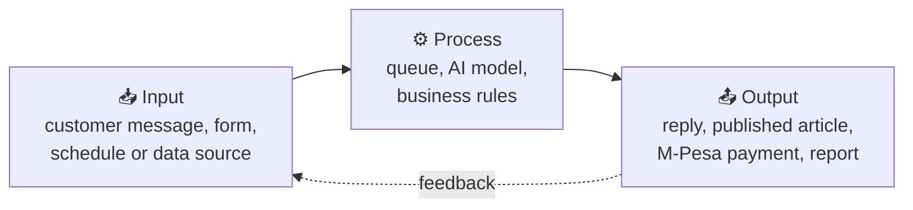
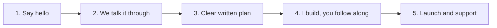

<!-- Animated wave header -->

  

<!-- Typing animation -->

  

  
  
  

  
  
  
  
  

---

## 👋 About Me

I'm David, a freelance full-stack developer based in Nairobi. I've been writing code since 2022, and I build **web applications, automation tools and chatbot platforms**. My recent work is focused on e-commerce, AI-powered content pipelines and multi-platform messaging, from storefronts and payment flows to the scrapers and bots that sit behind them.

I'm also curious about cybersecurity and Web3, and when I'm away from the keyboard I'm usually playing chess.

| | |
|---|---|
| 🧑‍💻 **Role** | Software developer & full-stack web developer |
| 📍 **Based in** | Nairobi, Kenya 🇰🇪 |
| 🎯 **Focus** | E-commerce · M-Pesa payments · AI content pipelines · Chatbots |
| 🗓️ **Coding since** | 2022 |
| 💼 **Status** | Freelancing, open to new projects |
| 🌐 **Portfolio** | [davidmuchiri.co.ke](https://www.davidmuchiri.co.ke) |

---

## 📊 By the Numbers

<table align="center">
<tr>
<td align="center" width="25%"><h2>26</h2>projects built and indexed</td>
<td align="center" width="25%"><h2>~4,000</h2>contributions in the last year</td>
<td align="center" width="25%"><h2>17+</h2>service pages on a single client site</td>
<td align="center" width="25%"><h2>2022</h2>year I started writing code</td>
</tr>
</table>

---

## 🛠️ Tech Stack

  

<b>Full breakdown</b>

 

**Languages**
 

**Frontend**
 

**Backend & data**
 

**Payments & integrations**
 

**Automation & AI**
 

---

## 🧰 What I Build

<table>
<tr>
<td width="50%" valign="top">

### 🛒 Online Shops
Stores with filters that fit what you sell, M-Pesa or card checkout, multi-currency pricing and an admin panel so you run the stock yourself.

</td>
<td width="50%" valign="top">

### 🌐 Business Websites
A page for every service, quote forms, and WhatsApp and call buttons where people are already looking, all tuned for local search.

</td>
</tr>
<tr>
<td width="50%" valign="top">

### 🤖 Chatbots
One shared engine that answers customers on WhatsApp and Telegram, designed to extend to Instagram and TikTok.

</td>
<td width="50%" valign="top">

### ⚙️ AI Automation
Content pipelines, scrapers, link audits and publishing workflows that replace repetitive research and publishing work.

</td>
</tr>
<tr>
<td width="50%" valign="top">

### 💳 Payment Integrations
M-Pesa STK Push, card payments, crypto gateways and donation flows with receipts and records your team can trust.

</td>
<td width="50%" valign="top">

### 📱 Web Apps & Dashboards
Custom applications and admin areas, from marketplaces to trading dashboards, built around your workflow.

</td>
</tr>
</table>

---

## 🚀 Featured Projects

Most client work lives in private repos, so each project links to a live site or a case study.

<table>
<tr>
<td width="50%" valign="top">

**[🎨 ArtCollect](https://www.artcollect.co.ke)** · [case study](https://www.davidmuchiri.co.ke/work/artcollect)
 
Marketplace for original art, editions and prints direct from East African artists, alongside community causes and opening-night events.
 
Next.js · TypeScript · CSS

</td>
<td width="50%" valign="top">

**[💎 GemSelect](https://gemstone-ljxp-rho.vercel.app)** · [case study](https://www.davidmuchiri.co.ke/work/gemselect)
 
Online gem shop with collector-grade filtering by shape, colour, clarity, treatment and origin, wishlists, multi-currency pricing, M-Pesa checkout and an admin panel.
 
Next.js · React · Prisma · M-Pesa

</td>
</tr>
<tr>
<td width="50%" valign="top">

**[🏗️ ProTech Consulting](https://www.pro-tech.co.ke)** · [case study](https://www.davidmuchiri.co.ke/work/protech-consulting)
 
Multi-service contractor site built to win enquiries: 17+ service pages, a quote estimator and WhatsApp lead capture, tuned for local search.
 
Next.js · Tailwind CSS · Framer Motion · Google APIs · SEO

</td>
<td width="50%" valign="top">

**[🌍 Davids Eye View](https://davids-eye-view.vercel.app)** · [code](https://github.com/its-muchiri/davids-eye-view)
 
The whole planet, live, in a browser tab. Aircraft, ships, satellites, earthquakes and public cameras on a photorealistic 3D globe you can control by voice.
 
Vite · CesiumJS · Realtime voice AI

</td>
</tr>
<tr>
<td width="50%" valign="top">

**[🤖 Multi-platform Chatbot](https://www.davidmuchiri.co.ke/work/multi-platform-chatbot)**
 
A chatbot platform that answers customers on WhatsApp and Telegram from one shared engine, with a job queue and Claude AI integration.
 
TypeScript · Prisma · BullMQ · Claude API

</td>
<td width="50%" valign="top">

**[📝 AI Blog Automation](https://www.davidmuchiri.co.ke/work/ai-blog-automation)**
 
Generates keyword-optimised articles with Claude or Gemini and publishes them to WordPress on a schedule, as a plugin or a Python tool.
 
Python · WordPress REST API

</td>
</tr>
</table>

<b>📚 See the full index of 26 projects</b>

 

| # | Project | Stack |
|---|---|---|
| 01 | [ArtCollect](https://www.davidmuchiri.co.ke/work/artcollect) | Next.js |
| 02 | [ProTech Consulting](https://www.davidmuchiri.co.ke/work/protech-consulting) | Next.js · React · Tailwind CSS |
| 03 | [ACK Berea Church](https://www.davidmuchiri.co.ke/work/ack-berea-church) | Vite · React · Tailwind CSS |
| 04 | [GemSelect](https://www.davidmuchiri.co.ke/work/gemselect) | Next.js · Vite · React |
| 05 | [Give to Africa](https://www.davidmuchiri.co.ke/work/give-to-africa) | Vite · React · Tailwind CSS |
| 06 | [Green Africa](https://www.davidmuchiri.co.ke/work/green-africa) | Next.js |
| 07 | [Davids Eye View](https://www.davidmuchiri.co.ke/work/davids-eye-view) | Vite · CesiumJS · Realtime voice AI |
| 08 | [Permalli Gas Suppliers](https://www.davidmuchiri.co.ke/work/permagas-co-ke) | Next.js · React · Tailwind CSS |
| 09 | [Solar.co.ke](https://www.davidmuchiri.co.ke/work/solar-co-ke) | PHP · JavaScript · CSS |
| 10 | [Event.co.ke](https://www.davidmuchiri.co.ke/work/event-co-ke) | PHP · JavaScript · CSS |
| 11 | [Rider.co.ke](https://www.davidmuchiri.co.ke/work/rider-co-ke) | PHP · JavaScript · CSS |
| 12 | [Laundry.co.ke](https://www.davidmuchiri.co.ke/work/laundry-co-ke) | PHP · JavaScript · CSS |
| 13 | [Construction.co.ke](https://www.davidmuchiri.co.ke/work/construction-co-ke) | PHP · Hack · JavaScript |
| 14 | [East Money Tattoos](https://www.davidmuchiri.co.ke/work/east-money-tattoos) | HTML · PHP · CSS |
| 15 | [Multi-platform Chatbot](https://www.davidmuchiri.co.ke/work/multi-platform-chatbot) | Prisma · TypeScript |
| 16 | [Premium Press Payment Gateway](https://www.davidmuchiri.co.ke/work/premium-press-payment-gateway) | PHP · CSS · JavaScript |
| 17 | [NOWPayments Plugin](https://www.davidmuchiri.co.ke/work/nowpayments-plugin) | PHP |
| 18 | [Lawyer Directory Scraper](https://www.davidmuchiri.co.ke/work/lawyer-directory-scraper) | Python · HTML |
| 19 | [Broken Links Tracker](https://www.davidmuchiri.co.ke/work/broken-links-tracker) | Python |
| 20 | [Kyu Chess Club](https://www.davidmuchiri.co.ke/work/kyu-chess-club) | C++ · PHP · C |
| 21 | [Rust for Machine Learning](https://www.davidmuchiri.co.ke/work/rust-for-machine-learning) | Rust |
| 22 | [Forex Bot Dashboard](https://www.davidmuchiri.co.ke/work/forex-bot-dashboard) | Python · TypeScript · JavaScript |
| 23 | [AI Blog Automation](https://www.davidmuchiri.co.ke/work/ai-blog-automation) | Python · WordPress REST API |
| 24 | [Timetable Calendar](https://www.davidmuchiri.co.ke/work/timetable-calendar) | React · Vite |
| 25 | [Task Manager](https://www.davidmuchiri.co.ke/work/task-manager) | JavaScript · HTML · TypeScript |
| 26 | [Event Page Template](https://www.davidmuchiri.co.ke/work/event-page-template) | Express |

---

## 🤝 Who I Work With

| Client type | What they need | What I build |
|---|---|---|
| 🏢 **Service businesses** (contractors, installers, clinics) | A steady flow of enquiries from search and mobile | A page per service, quote forms, WhatsApp and call buttons |
| ⛪ **Churches, NGOs, community groups** | To serve members online and receive giving without chasing transfers | Sermon libraries, events, M-Pesa giving and card donations with receipts |
| 💎 **Online sellers** (jewellers, gem and art dealers) | Shoppers who can find the exact item and pay their way | Stores with M-Pesa or card checkout and an admin panel |
| 🎨 **Creatives, galleries, studios** | A place that turns admirers into buyers or bookings | Image-first sites with collections, bookings and ticket links |
| 🚀 **Founders building a marketplace** | To test an idea before funding a full build | A written plan, data model and working scaffold, then a phased build |
| 📈 **Agencies & content teams** | Repetitive research and publishing done by software | Content pipelines, link audits, data collection and chat assistants |

---

## ⚡ How Automation Works

---

## 🧭 How I Work

| Terms | |
|---|---|
| 💰 **Payment** | 50% upfront to start, 50% on delivery |
| 🏦 **How you pay** | M-Pesa, bank transfer or Wise |
| 💱 **Currency** | Kenyan shillings, or US dollars for clients abroad |
| 📝 **Quote** | A written price and timeline before any work begins |
| 🔑 **Ownership** | The finished work is yours once the final payment is made |
| 🛟 **After launch** | Optional ongoing support on a simple monthly plan |

[Read the full process and terms →](https://www.davidmuchiri.co.ke/process)

---

## 📈 GitHub Stats

  
  

  

  

### 📅 Contribution Activity

  

### 🐍 Contribution Snake

  

---

## 🌱 Beyond the Code

- 🎓 **Power Learn Project:** student in the 2024–2025 cohort of #1MillionDevs4Africa
- ⛓️ **Solana Devs at Zetech:** member of the Blockchain & Web3 club
- 🔐 **Cybersecurity:** always learning, always curious
- 🦀 **Rust for Machine Learning:** side project exploring Rust beyond web work
- ♟️ **Chess:** when I'm not coding, I'm probably at a board

### 💼 Experience

| When | Role |
|---|---|
| Ongoing | **Freelance developer**: websites, web apps, e-commerce and automation for clients |
| Apr 2026 – Sep 2026 | **Elisa Travel Agency** |

---

## ✍️ Latest Writing

Practical guides for Kenyan freelancers and developers.

- [Kenya Freelance Rates Guide](https://www.davidmuchiri.co.ke/blog/freelance-rates-kenya)
- [Starting Freelancing in Kenya](https://www.davidmuchiri.co.ke/blog/starting-freelancing-kenya)
- [Ethical Web Scraping Quick Guide](https://www.davidmuchiri.co.ke/blog/scraping-ethical-quick)
- [Freelancing Tech Stacks for Kenya](https://www.davidmuchiri.co.ke/blog/freelancing-tech-stacks-guide)
- [Web Scraping Job Listings from Kenyan Boards: Ethical Guide](https://www.davidmuchiri.co.ke/blog/scrape-job-listings-ethical)

[Read all posts →](https://www.davidmuchiri.co.ke/blog)

---

## 🎯 Currently

- 🔭 Building AI automation and chatbot systems for Kenyan businesses
- 🌱 Learning more Rust, cybersecurity and Web3
- 💬 Ask me about M-Pesa integrations, WhatsApp bots, Next.js e-commerce and web scraping
- ⚡ Fun fact: I build the websites, the bots *and* the scrapers behind them

---

## 📫 Let's Connect

Got a shop, site or automation in mind? Tell me what you want to achieve, even if it's only a rough idea. No jargon, no pressure.

  
  
  
  
  

<i>Based in Nairobi, Kenya 🇰🇪 · Thanks for stopping by!</i>

<!-- Animated wave footer -->

  

